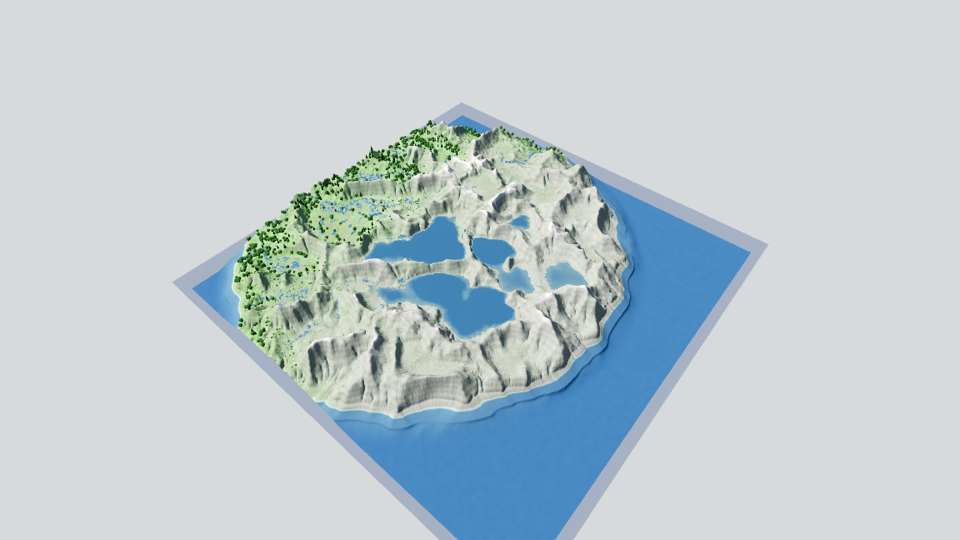
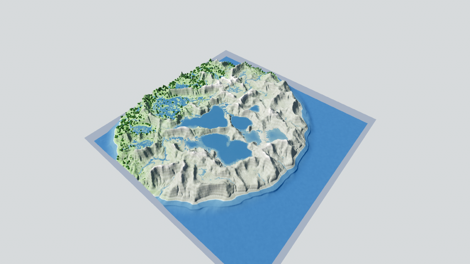
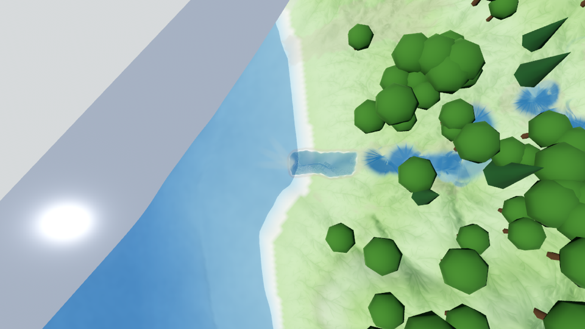
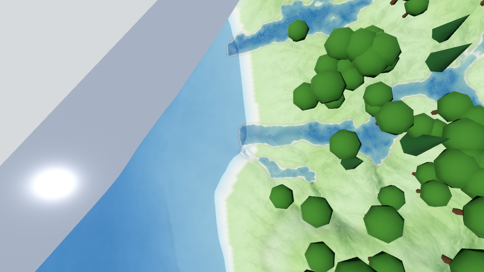
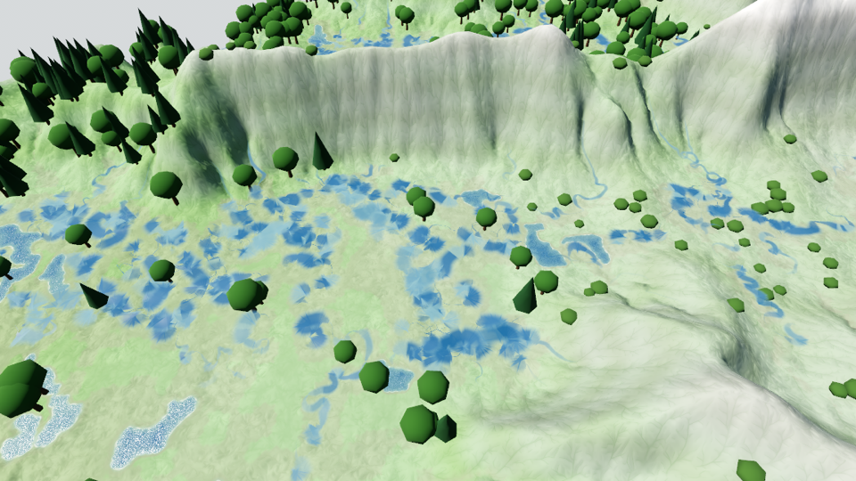
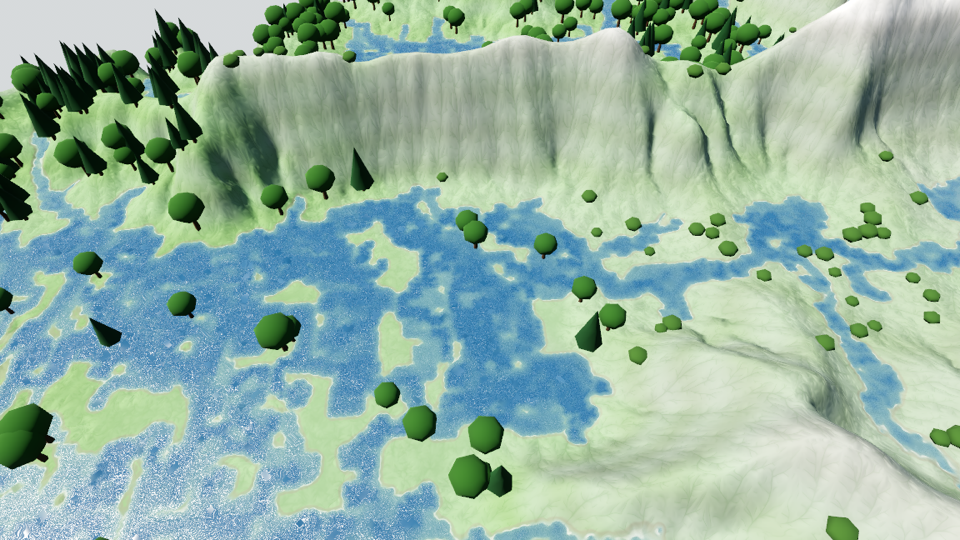
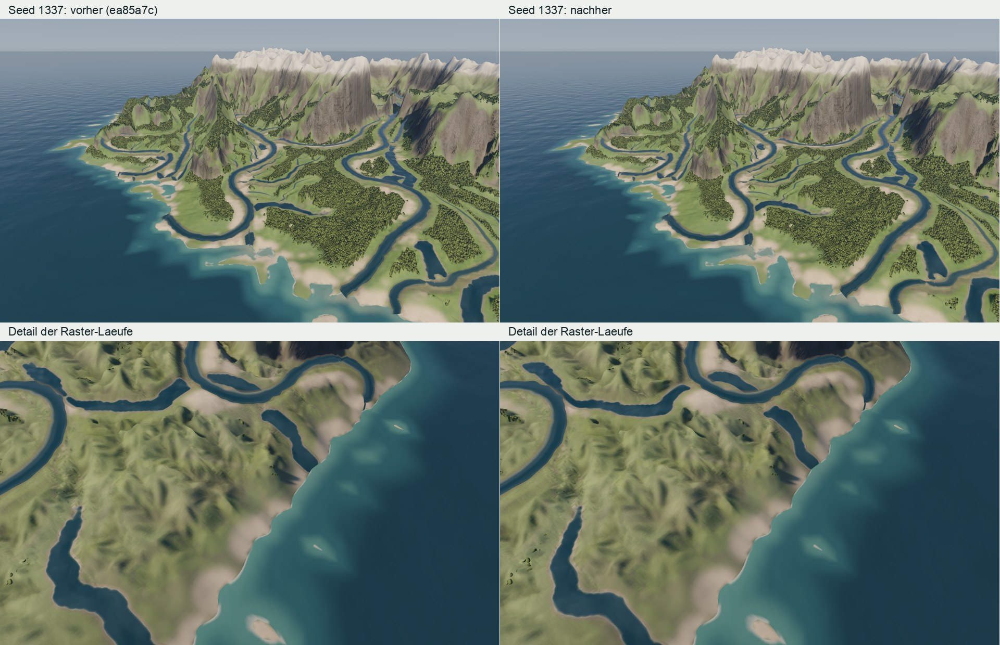
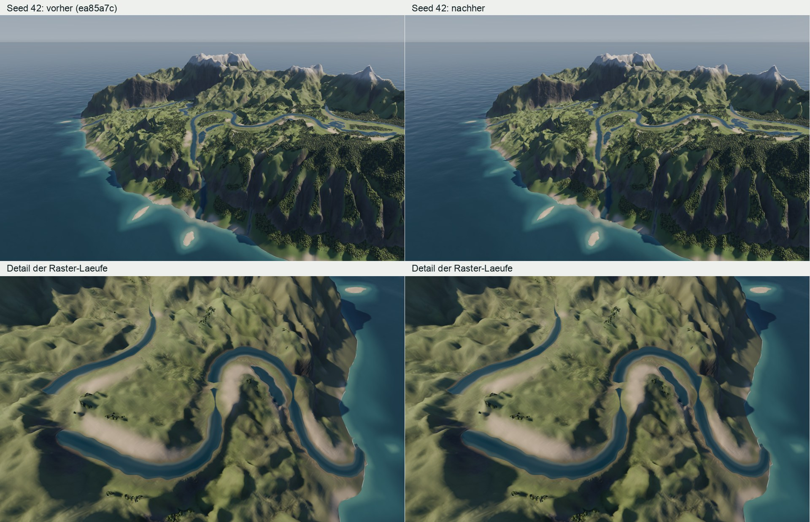
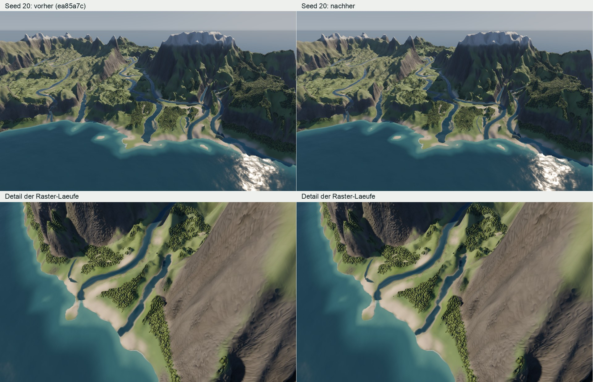

# Wasser als Geometrie: Mündungen, Deltas, Altarme (Issue #34)

Messprotokoll zum Abschluss des Geometrie-Umbaus (#31 Ribbons, #32 Seeufer, #34
Mündungen/Deltas/Altarme + Ablösung des Raster-Stempels). Alle Zahlen auf dem
M4-Max-Referenz-Mac, Godot 4.7.1, `n = 832`, `world = 130`.

Reproduzieren:

```sh
GODOT=…
"$GODOT" --headless --path game --script res://tests/water_geometry.gd   # Wächter
RS_SEED=907 RS_STEP=60000 "$GODOT" --headless --path game --script res://tests/water_geometry.gd  # Messlauf
RS_SEED=1337 RS_STEP=20000 RS_DIST=170 RS_SHOT=/tmp/a.png "$GODOT" --path game            # neu (Standard)
RS_WATER_STAMP=1 RS_SEED=1337 RS_STEP=20000 RS_DIST=170 RS_SHOT=/tmp/b.png "$GODOT" --path game  # alt (Stempel)
```

---

## A. Was die Sim an einer Mündung wirklich baut

Vor dem ersten Codezeilen-Schreiben gemessen (Ausgangsfrage: „woran erkennt man
ein Delta?"). Profil der Wassersäule entlang der Empfänger-Kette ab der
Uferlinie, an den 14 größten Mündungen, Seed 1337, Jahr 20.000:

| Mündung (i,j) | Einzugsgebiet (Zellen) | Wassersäule ab Ufer (16 Zellen) |
|---|---|---|
| (305,813) | 96.890 | 0.005 0.000 0.005 0.008 0.007 0.013 … 0.069 |
| (264,669) | 82.837 | 0.003 0.003 0.002 0.001 … 0.009 |
| (271,649) | 81.560 | 0.017 0.018 0.014 0.011 … 0.018 |
| (340,615) | 65.630 | **0.049** 0.046 0.044 0.038 … 0.023 |
| (354,595) | 65.416 | **0.037** 0.039 0.044 0.048 … 0.048 |
| (468,582) | 63.990 | **0.026** 0.023 0.023 0.015 … 0.022 |

Zwei Befunde, die den Entwurf bestimmt haben:

1. **Es gibt keine scharfe geologische Delta-Front.** Die Wassersäule steigt
   entweder langsam über viele Zellen (flacher Ablagerungskörper) oder liegt
   sofort bei 0.03–0.05 (Steilufer). Eine Schwelle „Delta = Tiefe < x" wäre
   also willkürlich gewesen — sie hätte auf jeder flachen Bucht ausgelöst.
   Kontrollgruppe (12 zufällige Küstenpunkte OHNE Fluss): im Mittel 48 Zellen
   unter 0.02 Wassersäule, also genauso flach wie an Mündungen.
2. **Es gibt eine scharfe RENDER-Grenze.** Das Raster-Wasserfeld malt eine
   Fläche erst ab `rawWet` = 0.03 Wassersäule als See (seichteres Ponding
   bleibt bewusst trocken, sonst „zu viele Seen"). Genau davor liegt eine Zone,
   die bisher **niemand** gemalt hat — der Saum zwischen Uferlinie und offenem
   Wasser.

Daraus die Leitregel von #34: **die Geometrie malt genau diese Zone, und hört
auf, wo das Raster übernimmt.** `WaterRender.deltaFrontDepth` IST deshalb
`WaterRender.lakeRawWetDepth` und keine zweite Kalibrierung daneben. Kein Spalt
(dazwischen liegt nichts Ungemaltes), kein doppeltes Wasser (übereinander liegt
nichts doppelt Gemaltes).

Das Meer folgt einer eigenen Regel: es ist keine Feld-Fläche, sondern eine
eigene Wasser-EBENE über der ganzen Karte, die ab der ersten Zelle unter `sea`
deckt. Dort gibt es nichts zu überbrücken — das Band blendet nach der STRECKE
aus (`mouthOverlapCells` = 2 Zellen), gerade genug, um den Diskretisierungs-
Versatz zwischen zell-gerundeter Zentrumslinie und per-Pixel-Uferkontur zu
schließen.

## B. Wächter-Zahlen (headless, `tests/water_geometry.gd`)

| Welt | Fluss-Bänder | Delta-Arme | Altarm-Bänder | Mündungen im Wasser | **mit Spalt** | max. Fluss-Alpha im Raster-Seewasser |
|---|---|---|---|---|---|---|
| Vorgabewelt, 20.000 J. | 248 | 20 | 65 | 116 | **0** | **0.0** |
| Seed 1337, 20.000 J. | 218 | 12 | 55 | 87 | **0** | **0.0** |
| Seed 1337, 60.000 J. | 263 | 12 | 5 | 4 | **0** | **0.0** |
| Seed 907, 20.000 J. | 72 | 6 | 6 | 3 | **0** | **0.0** |
| Seed 907, 60.000 J. | 66 | 9 | 0 | 0 | **0** | **0.0** |

- „Mit Spalt" zählt Fluss-Bänder, deren Ende TROCKEN liegt, obwohl der Lauf
  binnen 8 Zellen Wasser erreicht. Vor der Mündungs-Verlängerung: 8 (Seed 1337,
  20.000 J.), danach 0.
- „Max. Fluss-Alpha im Raster-Seewasser" ist die Overdraw-Probe: über jeder
  Zelle, die der See-Kanal malt (Wassersäule ≥ 0.03), muss die Band-Deckkraft 0
  sein. Vor der Übergabe-Regel: 1.0.
- Altarm-Bänder fallen mit der Zeit (55 → 5 bei Seed 1337): die Sim verlandet
  die Bögen, und `oxbowMaxAge` blendet den Rest aus. Seed 907 hat nach 60.000
  Jahren keinen wassergefüllten Altarm mehr — deshalb prüft der Wächter die
  EXISTENZ von Altarmen/Deltas nur in seiner Vorgabewelt und behandelt
  `RS_SEED`/`RS_STEP`-Läufe als Messläufe (Invarianten bleiben scharf).

## C. Drei Fehlerbilder, die erst der A/B-Screenshot gezeigt hat

Headless-Zahlen sagen nichts über Farbe und Höhe. Diese drei standen in keiner
Kennzahl:

1. **Dunkle Altarm-Haken auf der Seefläche.** Ein Altarm, der unter einem
   späteren See liegt, wurde vom Band gemalt UND vom See-Kanal — als dunkler
   Bogen auf hellem Blau. Fix: die See-Übergabe (`lakeHandoverFade`) gilt auch
   für Altarme; ein tief gefüllter Altarm IST ein kleiner See und wird als
   solcher gerendert (Uferkontur + Komponenten-Fade aus #32).
2. **Schwebende Platte vor jeder Meeres-Mündung.** Das Band lag auf
   `Wasserspiegel + RIVER_LIFT` (0.35 Welt-Y) — über der Meeres-Ebene statt in
   ihr. Zusätzlich stempelte der Korridor-Halo den Ufer-Saum auf den
   MEERESGRUND: dort ist `pond` per Definition 0, der Saum also voll
   eingeschaltet, und unter der durchscheinenden Wasser-Ebene stand ein helles
   Sand-Rechteck. Fix: Bänder auf Wasser liegen auf dem Spiegel (am Meer knapp
   darunter, dann lesen sie sich als Trübung IM Wasser), und der Korridor
   stempelt nicht unter die Meeresoberfläche.
3. **Drei helle Strahlen statt eines Fächers.** Die Delta-Arme waren so breit
   wie der Lauf und liefen mit voller Deckkraft bis zum Längen-Deckel (14
   Zellen) — auf flachen Schelfen quer durch die halbe Bucht. Fix: Mindest-
   Armbreite (der Strom verliert an der Mündung seine Tiefe, nicht sein
   Wasser), Deckkraft 0.55 → 0.35, Deckel 14 → 10 Zellen.

## D. Was BEWUSST Raster bleibt

| Anteil | Pfad | Begründung |
|---|---|---|
| Mäander-Hauptläufe, Deltas, Altarme | **Geometrie** | Persistente Entitäten mit Zentrumslinie; Breite ∝ √Abfluss statt Zell-Quantisierung |
| Dendritische Zubringer unter der Mäander-Schwelle (Stream-Map × MFD) | **Raster** | Sie haben keine Zentrumslinien-Entität, aus der ein Band entstehen könnte — und sie tragen den größten Teil der Talzeichnung. Ein Band je Rinnsal wäre die alte „zu viele Flüsse"-Optik in teuer. |
| Braid-Sprenkel (Nebenarme aus dem MFD-Netz) | **Raster** | Dasselbe Argument; Braiding ist eine FLÄCHEN-Eigenschaft (Bänke/Arme), keine Linie |
| Seen und Meer | **Raster + Shader** | Die Uferlinie entsteht seit #32 PRO PIXEL aus der Wassersäule — feiner, als eine Kontur-Triangulierung es könnte |
| Nass-Saum (`shore`) um alles | **Raster** | Er ist ein LAND-Effekt auf der Terrain-Farbe, keine Wasserfläche |

Was **abgelöst** ist: der Zentrumslinien-Stempel (malte den Lauf ins Wasserfeld;
trägt jetzt nur noch Saum-Intensität als Nass-Halo unter dem Band) und das
Altarm-Overlay im See-Kanal. Beides ist über `RS_WATER_STAMP=1` weiter
lauffähig — als A/B-Vergleichsarm, nicht als Alternative.

## E. Perf (M4 Max, `RS_FPS`, Zeitraffer 60 J/s, Übersicht `RS_DIST=170`)

| Messung | Geometrie (Standard) | Stempel (`RS_WATER_STAMP`) |
|---|---|---|
| FPS im Zeitraffer (3 Läufe) | 25,7 / 26,3 / 25,6 | 27,6 / 29,3 / 29,3 |
| FPS im Leerlauf (2 Läufe) | 79,6 / 80,1 | 80,0 / 79,0 |
| `terrain_texupload_ms` (RS_DIAG, 10×) | 16,3 | 13,8 |
| `buildRiverRibbons` (Wächter) | 3,6–7,8 ms | — |
| `step(60 J.)` | 114,1 ms | 115,1 ms |

Lesart: **im Leerlauf kostet die Geometrie nichts** (die zusätzliche Fläche mit
~60.000 Vertices ist gegen das Terrain-Displacement unsichtbar). Die ~10 % im
Zeitraffer stecken fast vollständig in der Wasser-Aufbereitung pro Textur-Update
(+2,5 ms): der Korridor-Halo deckt im Geometrie-Modus die volle Bandbreite
(Radius bis 4 Zellen statt 1). `buildRiverRibbons` selbst ist mit ≤ 8 ms bei
1 Hz Deckel nachrangig. Drei Vollbild-Schleifen wurden dafür in EINE
zusammengelegt (`rawWet` + Korridor-Deckel + Altarm-Saum): 16,7 → 16,3 ms.
Die Sim-Zeit ist unberührt (114 vs. 115 ms — Rauschen), wie es sein muss.

## F. Optik-Vergleich (A/B, Seed 1337, Jahr 20.000)

| Neu (Geometrie) | Alt (Stempel) |
|---|---|
|  |  |
|  |  |
|  |  |

- **Übersicht:** der Stempel-Pfad sprenkelt die Ebenen mit blauen Flecken
  (Zentrumslinien-Stempel + Altarm-Overlay über verknäulten Altpfaden). Die
  Geometrie zeigt Seen als Seen und Läufe als Linien.
- **Mündung (Aufsicht, Meeresküste):** links läuft das Band bis in die
  Uferkontur und blendet dort aus, davor liegt der Delta-Fächer als schwache
  Trübungsfahne. Rechts endet der gestempelte Lauf als breiter blauer Klecks vor
  der Küste.
- **Aue (Braid-Ebene):** der deutlichste Unterschied. Der Stempel-Pfad flutet
  die Ebene flächig blau („zu viel Wasser"), die Geometrie zeigt einzelne Arme
  und Tümpel mit trockenem Land dazwischen.

## G. Wächter

- `SimCoreTests/WaterRenderTests.swift` — pinnt die neuen Kalibrier-PAARUNGEN
  (Delta-Front == Raster-See-Schwelle, Typ-Kanal ↔ Shader-Gewichte) und
  vergleicht sie gegen den echten Quelltext von `water.gdshader` und
  `SimNode.swift`.
- `game/tests/water_geometry.gd` — Mündungs-Abschluss, Overdraw, Typen,
  Stillwasser-Kodierung, Physik-Neutralität, Determinismus.
- `game/tests/river_ribbons.gd` — der Band-Vertrag aus #31, um die
  Wasserspiegel-Ausnahme erweitert.

## H. Raster-Läufe ohne Kästen (Issue #174)

Messung am 18.10.2026 auf dem M4 Max, 16 CPU-Kerne, macOS 26.7,
Release / Swift-5-Sprachmodus. Ausgangsstand ist `ea85a7c`, übernommener
Entwurf `9acb962`. Der Cherry-Pick auf den neueren Delta-Stand war konfliktfrei.

### Befund und Verfahren

Die auffälligen dunklen Rechtecke auf den Ebenen tragen den Raster-Fluss-Kanal.
Die alte Verbreiterung las vier Nachbarn in zwei Pässen. Auf einer geraden
D8-/MFD-Linie entstehen so Streifen mit konstanter Breite, stumpfen Köpfen
und Achs- bzw. 45°-Kanten. Echte Seen und Altarme müssen sichtbar bleiben;
dunkles Wasser allein ist kein Kriterium zum Entfernen einer Fläche.

`RiverWidening` stempelt stattdessen runde Querschnitte. Ihr Radius wächst mit
der Intensität. Die ersten sechs kräftigen Zellen am Laufkopf verjüngen ihn;
statisches Gitterrauschen verändert Breite und Lage. Bei vielen benachbarten
kräftigen Zellen sinkt die Verbreiterung, damit ein Bündel nicht noch über
seinen äußersten Strang hinaus zur Fläche wächst. Die ursprüngliche Linie
bleibt erhalten. Unterhalb der Verbreiterungsschwelle entsteht keine neue
Breite. Alle Werte stehen in `WaterRender.widen*`.

Die Bank-Schranke bleibt symmetrisch und fest bei 0,004 Sim-Höhen Abstand
zwischen Zielbett und Quell-Wasserspiegel. Der übernommene Entwurf
multiplizierte diese Toleranz mit dem Abstand. Das ließ niedrige Bänke und
Zellen unter Geländestufen nass werden. Der neue Wächter
`testWideningKeepsLowBanksAndSteepDropsDry` prüft beide Vorzeichen mit 0,006
Höhenunterschied; der unveränderte Entwurf malt dabei 388 verbotene Zellen.
Mit der festen Schranke sind es 0.

Die Verbreiterung schreibt sequenziell per Maximum. Es gibt keine konkurrierenden
Stempel und keine Abhängigkeit von der Thread-Zahl. Die Sim-Physik und die
See-Übergabe `lakeRawWetDepth` bleiben unverändert.

### Kalibrierung und verworfene Varianten

| Größe | Wert | Wirkung |
|---|---:|---|
| Intensitäts-Stützstellen | 0,55 / 0,8 | Bäche unter der ersten bleiben unverbreitert |
| Kernradius an erster / zweiter Stützstelle / bei Intensität 1 | 1 / 1,1 / 1,35 Zellen | stetige Breitenhierarchie oberhalb der Schwelle |
| Schulter | 1 Zelle | Intensität fällt außerhalb des Kerns auf 0 |
| Radius-Schwankung / Rausch-Gitterabstand | ±40 % / 12 Zellen | variable Breite ohne zeitliches Rauschen |
| Mittelpunktversatz | 2,4 Grundradien × Rauschen | lockert die zellgerade Kontur |
| Kopf-Verjüngung | 0,35 → 1 über 6 kräftige Vorgänger | schmaler Beginn; die Originallinie bleibt |
| Dichte-Fenster / Rampe / kleinster Faktor | 7×7 / 0,2…0,5 / 0,55 | weniger zusätzliches Wasser in dichten Bündeln |
| Intensitätsverlust je Zelle / Bank-Toleranz | 0,09 / 0,004 | lesbare Ufer; feste Höhen-Schranke |

Verworfen sind die alte Diamant-Dilatation und die mit dem Abstand wachsende
Bank-Toleranz aus dem Entwurf. Die Radien, Schulter und Formvariation des
Entwurfs bleiben nach dem Bildvergleich erhalten. Der Kommentar über eine
angeblich gemessene Simplex-Variante wurde entfernt: im übernommenen Stand
lag dazu kein reproduzierbares Vergleichsprotokoll vor.

Der Entwurf maß außerdem die isolierte Verbreiterung auf einem aus fertigen
RGBA-Bytes zurückgerechneten Feld. Dieses Feld war bereits verbreitert,
geglättet und gedeckelt. Diese Zahl ist keine Messung der Produktions-Eingabe
und wird hier nicht verwendet. Gemessen wird der vollständige Wasserfeld-Aufruf.

### Kosten

`testRectWaterCostDiagnostic` erzeugt je Seed frisch eine Produktionswelt:
`n = 720`, `world = 112,4789`, Produktions-Einlauf 3000 Jahre, danach
20 × 1000 Jahre. Keine Wiederverwendung alter `/tmp`-Snapshots. Bänder einmal
bauen, beide Renderer aufwärmen, dann 40 Paare mit wechselnder Reihenfolge
AB/BA. Gemessen wird jeder einzelne vollständige `bytes`-Aufruf einschließlich
Blur, EWMA, Quantisierung, Komponenten und Bank-Schranke; `blend = 1`,
Geometrie-Modus. Die Headless-Welt zeigt den Zustand nach dem letzten Schritt,
ohne den zusätzlichen manuellen Abfluss-/Seespiegel-Neuaufbau der Screenshot-Bühne.
Während dieser Messung liefen keine eigenen Screenshot-, Build- oder Suite-Prozesse.

| Seed | Diamant, Median ms | Scheibe, Median ms | Mehrkosten ms | Anteil der Mehrkosten an 33,3 ms |
|---|---:|---:|---:|---:|
| 1337 | 11,18 | 12,55 | +1,37 | 4,1 % |
| 42 | 8,40 | 8,94 | +0,54 | 1,6 % |
| 20 | 8,67 | 9,68 | +1,01 | 3,0 % |

Das ist eine Mehrlast, keine Optimierung. Die Tabelle ist auch keine
Bildraten-Messung: die Wasser-Aufbereitung läuft im Zeitraffer im Hintergrund
und die Overlays werden gedrosselt. Der vollständige Frame mit GPU und Upload
wurde hier nicht vermessen. Im übernommenen Entwurf lagen die vorläufigen
Mediane für 1337 bei 11,08 → 12,34 ms und für 42 bei 8,59 → 9,36 ms,
10 interleaved Blöcke à 6 Aufrufe. Diese Blockmittel sind eine andere Statistik
als die 40 Einzel-Aufrufe der Endmessung; daraus folgt keine belastbare
Beschleunigung durch die Bank-Korrektur.

Reproduktion, beide Diagnose-Tests sind hinter `RS_MEASURE=1`:

```sh
RS_MEASURE=1 swift test -c release --package-path SimCore \
    --filter testRectWaterCostDiagnostic
RS_MEASURE=1 swift test -c release --package-path SimCore \
    --filter testRectWaterDiagnostic
```

`WaterFieldRenderer.legacyWiden` hält intern den alten Vergleichsarm; für
Bildvergleiche im selben Build setzt `RS_WIDEN_DIAMOND=1` ihn ebenfalls.
Die Endbilder unten vergleichen dennoch die echte Library von `ea85a7c`
mit dem neuen Build.

### Formmessung und Grenzen

`testRectWaterDiagnostic` liest die tatsächlichen Renderer-Bytes durch die
Fluss- und See-Fenster des Shaders, ab Maskenwert 0,5, außerhalb der Banddeckung
von 0,3. Komponenten sind über vier Nachbarn verbunden. Ein Kasten ist hier
rein geometrisch definiert: mindestens 30 Zellen, Füllgrad des kleinsten
Rechtecks im 5°-Raster mindestens 0,75, Streckung mindestens 2. Eine Komponente
mit überwiegend gerader Kante hat mindestens 20 Zellen und mindestens 50 %
ihrer Randkanten in achsparallelen Läufen von mindestens sechs Zellen.

| Seed | Kasten-Komponenten / Zellen alt → neu | Komponenten / Zellen mit überwiegend gerader Kante alt → neu |
|---|---|---|
| 1337 | 1 / 70 → 1 / 30 | 4 / 226 → 1 / 26 |
| 42 | 1 / 67 → 0 / 0 | 3 / 121 → 2 / 54 |
| 20 | 0 / 0 → 0 / 0 | 0 / 0 → 0 / 0 |

Die Konturen werden weniger rechteckig, die Drainage bleibt ein Raster.
Die Messung verspricht deshalb keine vollständige Beseitigung gerader Stücke.
Bei 1337 bleibt ein anderer kleiner Kasten bei Zelle 59/370 mit 30 Zellen
übrig. Auch ein echter länglicher See erfüllt je nach Form ein Streifenmaß.
Über beide Wasserkanäle sind 124 / 10 / 81 früher sichtbare Zellen in den
Seeds 1337 / 42 / 20 weiter als drei Zellen von neu sichtbarem Wasser entfernt;
davon liegen 59 / 10 / 56 nahe einem Band. Das ist ein Grenzwertvergleich von
Komponenten und Konturen, keine Zusage über identische Wasserfläche.
Die Tests prüfen die erhaltene Originallinie, schwache Läufe, spitze Köpfe,
variable Breite, Dichte-Dämpfung, Bank-Schranke und die Band/See-Übergabe direkt.

### Bildvergleich

Alle neun Kombinationen aus Seeds 1337 / 42 / 20 und `valley` / `close` /
`diorama`, Jahr 20.000, wurden vorher und nachher frisch aufgenommen und
angesehen. Die Vorher-Library stammt aus einem sauberen Checkout von `ea85a7c`;
Quell- und Library-Stempel stimmen überein:
`fc3ea824dd5e9c66d0f85fdf70a98b88cb64d49fbafde904b77609b104ca1583`.
Der neue Build wurde mit `RS_NO_SHARED_BUILD=1` gebaut und importiert.

Fenster jeweils maximiert, Viewport **3456 × 2104**. Es war nur das interne
Display angeschlossen: `--screen 1` meldete `screen_count = 1`; alle gültigen
Vergleichsaufnahmen verwenden deshalb `--screen 0`. Die erste Aufnahme mit
der ungültigen Bildschirmnummer wurde erneut aufgenommen und nicht verwendet.

Die Gesamtansichten ändern sich wenig, weil die Hauptläufe überwiegend
Band-Geometrie sind. An den Raster-Läufen sind die Konturen runder und die
Breiten weniger konstant; Bäche bleiben dünn. Zusätzlich zeigen drei feste
Nahansichten die in der Diagnose auffälligen Läufe. Gleiche Kamera vor/nachher:

| Seed | `RS_TARGET` | Weitere Werte |
|---|---|---|
| 1337 | `35.6,-3.7` | `RS_DIST=12 RS_YAW=0.7 RS_PITCH=1.0` |
| 42 | `34.9,4.8` | gleich |
| 20 | `3.7,41.1` | gleich |

Je Tafel oben das Tal-Preset, unten diese Nahansicht, links vorher und rechts
nachher. Die Originale liegen unter `/tmp/rw/<Seed>_<Kamera>_before.png` und
`/tmp/rw/<Seed>_<Kamera>_after.png`, mit `focus` für die feste Nahansicht.
Die JPEG-Tafeln bleiben im Repo, auch wenn `/tmp` gelöscht wird.





Die nadeldünne dunkle Linie vor der Lagune in Seed 1337 bleibt ein separater
Befund am Bandende, keine Diamant-Verbreiterung. Eine Projektion der tatsächlich
gebauten Bandpunkte trifft dort den Höhenwechsel von Zentrum
`(-46,448; 3,932; 8,587)` zu `(-46,518; 3,540; 8,655)`, bei nur rund 0,145
Welteinheiten Bandbreite und Deckkraft 0,41 → 0,38. Das ist die Übergabe von
der angehobenen Land-Geometrie an die Meeresfläche. Sie bleibt für die parallel
bearbeitete Küsten-/Bandenden-Korrektur unangetastet. Die Scheiben ändern die
Raster-Fläche daneben, nicht diesen Höhenwechsel.

### Verifikation

- Gesamte SimCore-Pflichtsuite: **606 Tests, 70 Messläufe übersprungen,
  0 Fehler**, 207,4 Sekunden. Die neuen Form- und Bank-Wächter laufen ohne
  Mess-Schalter; nur die beiden Tabellen-Läufe sind gegatet.
- `smoke.gd`, `water_geometry.gd`, `river_ribbons.gd`, `water_uniforms.gd`,
  `canopy.gd`, `relief.gd`: alle sechs Erfolgsmarken über `scripts/godot-test.sh`.
- `simperf --hash` vor und nach der Änderung:
  **`08d32575d5cd353a`**, gleiche Maschine, Standardlauf des Harness.
- Eigenständiger Extension-Release-Build mit `RS_NO_SHARED_BUILD=1`,
  Schlusszeile „macOS-GDExtension gebaut und signiert“, Build-Stempel-Prüfung
  erfolgreich. Import wiederholt erfolgreich. Der erste Import hatte alle
  Phasen abgeschlossen und brach anschließend beim Beenden mit Signal 11 ab;
  der zweite lief sauber durch.

Bestehender Engine-Befund: `relief.gd` druckt beim Waldmasken-Upload nach
Neu-Generieren `ERROR: Invalid image`, erreicht aber `RELIEF_OK`. Derselbe
Lauf auf dem unveränderten `ea85a7c` reproduziert dieselbe Meldung und besteht
ebenfalls. Der Befund gehört nicht zur Raster-Verbreiterung und wurde nicht
im Zuge dieses Fixes verändert. Vollständige lokale Protokolle stehen in
`/tmp/rw/suite.log`, `final-diagnostics.log`, `hash-before.log`, `hash-after.log`
und `contract-*.log`.
