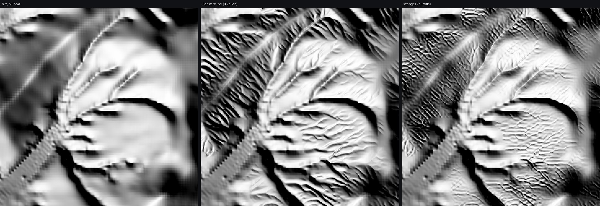
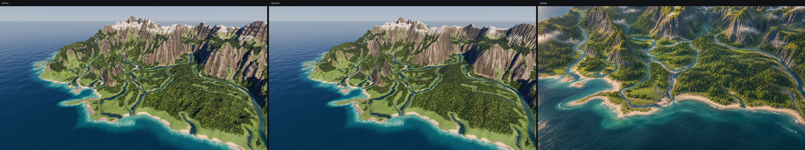
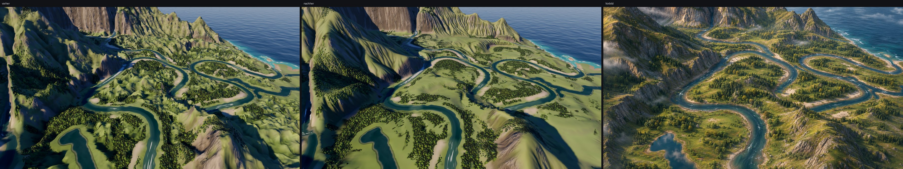
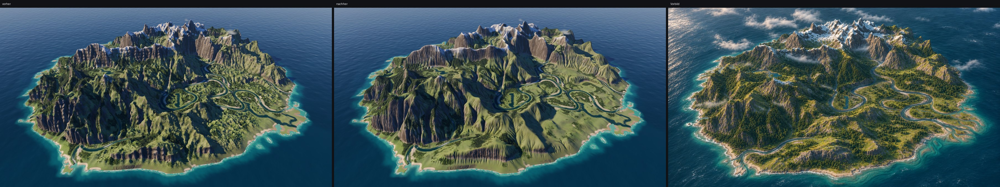
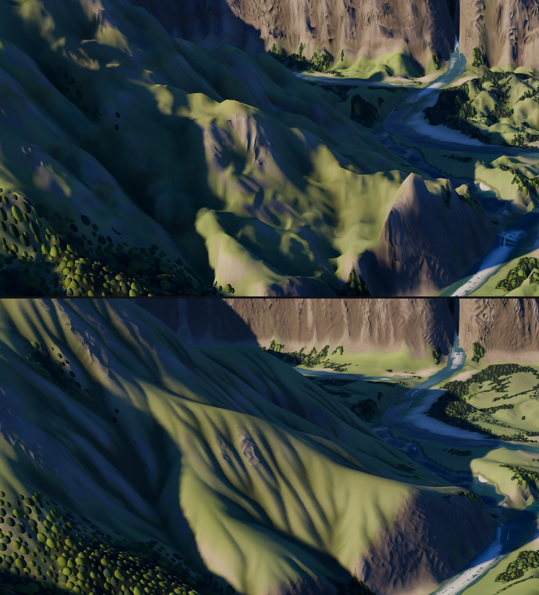
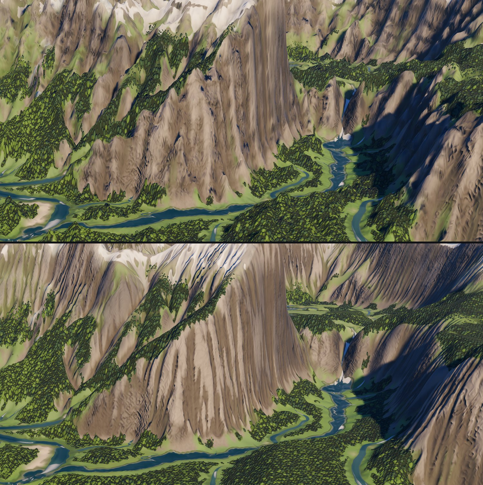
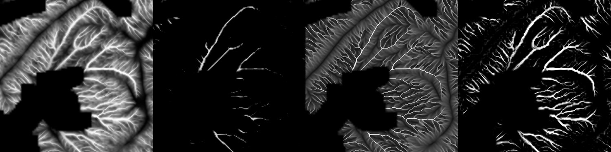
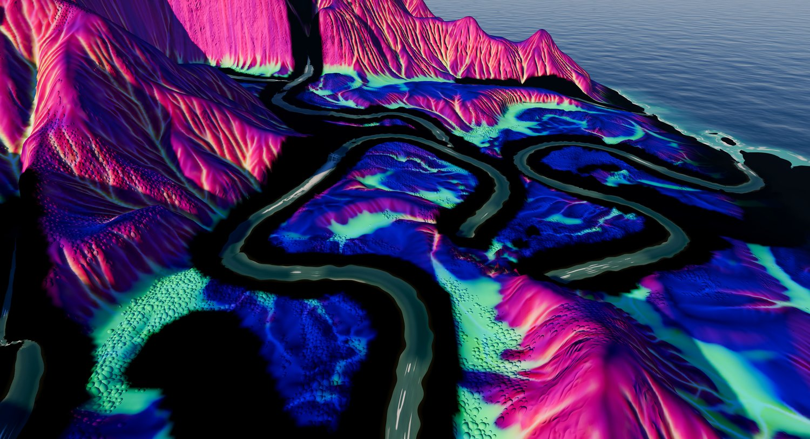

# Look D: Gelände-Verfeinerung auf der GPU (#238)

Stand 21. November 2026, Phase 1. Phase 2 (die verfeinerte Fläche als
Geometrie auf den Kacheln aus #235) steht aus, s. § Offen.

Aus der Sim-Höhe (720², 15,6 m je Zelle) rechnet die GPU eine Fläche in
vierfacher Auflösung (2880², 3,9 m je Texel) und vier Karten fürs Material.
Vorbild ist Schott, Galin, Guérin, Paris, Peytavie: "Terrain Amplification
using Multi-scale Erosion" (2024), Code unter MIT
(<https://github.com/H-Schott/MultiScaleErosion>): hochskalieren in
Zweierschritten, auf jeder Stufe nacherodieren. Es ist nur Darstellung. Die
Sim bleibt auf der CPU, nichts geht zurück, `simperf --hash` ist unverändert.

## Aufbau

`game/scripts/TerrainAmplifier.gd` treibt Compute-Shader über Godots
`RenderingDevice`, die Shader liegen in `game/shaders/amplify/`. Der Ordner
trägt `.gdignore`: Godot importiert die Dateien nicht, der Verfeinerer
übersetzt sie beim Start aus dem Quelltext (so kommt `common.glsl` ohne
Import-Mechanik vor jeden Pass).

| Pass | Auflösung | Aufgabe |
| --- | --- | --- |
| `mask` | 720² | wo die Verfeinerung wirken darf (Schutzmaske, Küstensaum), weich auslaufend |
| `ingest` | 1440² | Sim-Höhe bikubisch auf Stufe 1, dazu Härte-Rauschen aus der Position |
| `step` × 48 | 1440² | Abfluss sammeln, Stream-Power-Abtrag, thermischer Abtrag, Ablagerung |
| `refine` | 2880² | Stufe 1 bikubisch auf Stufe 2 |
| `step` × 24 | 2880² | dieselben Schritte eine Stufe feiner |
| `mean`, `mean_solve` | 720² | Mittel der Abweichung und das Korrekturfeld dazu |
| `bind` | 2880² | Bindung an die Sim (s. u.) |
| `encode` | 2880² | Ausgabe: Fläche im Vertrag der Backtextur, Karten |
| `mip` × 12 | 1440² … 45² | Mip-Ketten beider Ausgaben |

Ausgabe sind zwei Texturen mit je sieben Mip-Stufen:

- `relief_tex` (RGBA16F) im Vertrag von `relief_bake.gdshader`: R
  Höhenzuschlag, GB Steigungszuschlag, A Rinne (−) / Rippe (+). Terrain-Shader,
  Pinselkuppel, Raycast und Kameraziel lesen sie unverändert.
- `amplify_tex` (RGBA8): R Abtrag, G Ablagerung, B Abfluss, A Schutt.

### Was vom Vorbild abweicht

Das Vorbild rechnet für 256² → 2048² rund 18.000 Schritte, einmal, offline.
Hier ändert sich der Eingang viermal je Sekunde. Daraus folgt alles Weitere:

- **72 Schritte statt Tausende, auf zwei Stufen.** Die groben Formen hat die
  Sim schon erodiert. Die Verfeinerung trägt den Abfluss nur so weit, wie eine
  Rinne am Hang lang ist (48 Texel auf Stufe 1 sind 24 Zellen, 375 m).
- **Ein Pass je Schritt statt drei.** Abtrag, thermischer Abtrag und
  Ablagerung lesen dieselbe 3×3-Nachbarschaft.
- **Abfluss-Anteile aus den Höhen des Vorschritts.** Das Vorbild rechnet die
  Normierung jedes Nachbarn aus dessen 3×3 neu, das sind 25 Abgriffe je Texel.
  Hier führt jedes Texel seine Normierung mit, und der Zufluss rechnet mit den
  Höhen, zu denen sie gehört. Die Anteile summieren exakt zu eins. Der erste
  Versuch nahm die Normierung des Vorschritts auf den neuen Höhen: der Abfluss
  wuchs auf Flächen unbegrenzt, alles lief in die Schranke.
- **Thermisch stetig.** Das Vorbild verschiebt feste Quanten je Nachbar über
  dem Schüttwinkel, eine Sprungfunktion des Eingangs. Hier gleicht ein
  paarweise erhaltender Fluss proportional zum Überschuss aus, mit einem
  Schüttwinkel je Paar. Der ist nie flacher als das 1,3-Fache des Gefälles
  der Sim-Fläche: mit dem festen Winkel allein rutschten die Steilwände der
  Sim über mehrere Zellen ab.
- **Sediment ist das wirklich Abgetragene.** Das Vorbild speist Sediment frei
  aus der Transportkraft. In unseren Einheiten (eine Welteinheit sind 100 m)
  schüttete das je Schritt mehrere Meter auf.
- **Abtrag weich gesättigt** bei der halben Stufe zum tiefsten Nachbarn statt
  hart am steilsten Empfänger. Mit dem harten Deckel fielen Rinnen je Schritt
  ganz hinunter, es entstanden Ebenen und ein Schachbrett.
- **Stärke nach Steilheit.** `bind.glsl` skaliert die Abweichung mit dem
  Gefälle der Sim-Fläche: 0,6 im sanften Gelände, 1,2 an Steilwänden (Gefälle
  0,8 bis 1,8 wie die Felsrippen des Back-Passes). In voller Stärke las der
  Abtrag als zerfurchtes Ödland, an Felswänden von hunderten Metern trägt er
  dagegen mehr.
- **Gebietsweise ruhiger.** Ein grobes Rauschen aus der Position
  (Wellenlänge 56 Zellen) nimmt die Stärke gebietsweise bis auf 30 % zurück.
  Überall gleich stark las das Gelände in der Totalen als gekämmt, s. § Bild.
- **Härte aus der Position.** Ein Rauschen in Weltkoordinaten (Wellenlängen 5,
  2,2 und 0,9 Zellen) moduliert den Abtrag. Es entscheidet, wo auf einer
  glatten Wand eine Rinne entsteht, und zwar an festem Ort statt nach dem
  Takt-Rauschen der Sim.

## Bindung an die Sim

`bind.glsl` macht aus der verfeinerten Fläche die Abweichung von der
bilinearen Sim-Höhe. Geprüft in `game/tests/amplify.gd`:

| Regel | Umsetzung | Gemessen (Seed 1337, Jahr 20.000) |
| --- | --- | --- |
| feste Schranke | weich gedeckelt bei −0,30 / +0,20 Welteinheiten (30 m / 20 m) | −0,30 … +0,19, Median des Betrags 0,02 (2 m), p99 0,22 |
| Wasser, Bänder, Saum | Schutzmaske #154: Abweichung exakt null | max. 0 |
| Küstenlinie | unter Meeresspiegel + 0,008 exakt null, je Texel | max. 0 |
| Wasserspiegel | ab der Tümpeltiefe des Terrain-Shaders (`WaterRender.pondContourLo`) nie darüber | max. 0 |
| Mittel | Fenster über σ = 3 Zellen, s. u. | Mittel über das freie Land 0,0008 (8 cm) |

Die Maske ist in der Schutzmaske samt einem Ring Nachbarzellen null und
läuft dahinter über rund drei Zellen weich aus (`mask.glsl`). Der Ring ist
nötig, weil `bind.glsl` die Maske bilinear liest: ohne ihn wäre sie nur in
der Mitte einer geschützten Zelle null, nicht auf ihrer ganzen Fläche (so
war es auch im Back-Pass). Bilinear aus der binären Schutzmaske allein stand
außerdem an jeder Maskenkante eine Treppe aus Zellen.

Die Schranke greift nach dem Abziehen des Mittels. Zuerst gebaut war es
umgekehrt, und das kostete das halbe Bild: Am Steilhang senkt der Abtrag
alles gleichmäßig um 30 bis 60 m, die rohe Abweichung lag dort also schon
weit in der Sättigung, und die weiche Schranke drückte die Rinnen darauf
platt. Felswände blieben glatt, der Bewerter zog in `tal` den alten Stand 9
zu 1 vor.

Zur Wasserregel: Die gefüllte Fläche der Sim (`filled`) liegt auf zwei
Dritteln des Landes um Zentimeter über dem Gelände. Eine Schwelle bei null
hätte dort jedes Anheben verboten. Die Regel greift deshalb ab der Tiefe, ab
der das Spiel Wasser zeigt.

### Zellmittel: streng geht, kostet aber das Bild

Das Issue verlangt, dass die Verfeinerung das Zellmittel erhält. Das ist
gebaut und geprüft (`mean_window = 0`): das Mittel jeder freien Zelle weicht
dann im p99 um 0,0024 Welteinheiten (24 cm) ab, höchstens um 0,017 dort,
wo die Schranke greift (sie geht vor). Voreingestellt ist es nicht,
und das ist eine Entscheidung für den Eigner.

Der Grund: Eine Rinne ist ein bis vier Zellen breit. Eine Form, die breiter
ist als eine Zelle, ändert Zellmittel, anders geht es nicht. Streng muss jede
Zelle für sich im Mittel auf der Sim-Höhe liegen, eine durchlaufende Rinne
zerfällt dann in zellgroße Bruchstücke:



Voreingestellt ist deshalb ein Fenster: Die Verfeinerung erhält das Mittel
über eine Gauß-Glocke von σ = 3 Zellen (47 m). Großräumig weicht sie nicht
von der Sim ab, Rinnen bis etwa vier Zellen Breite bleiben stehen. Die
Schranke, die Schutzmaske und die Küste gelten in beiden Fassungen je Texel.

## Stabilität

Gleicher Eingang gibt bit-gleichen Ausgang (feste Schrittzahl, Rauschen nur
aus der Position, kein Zustand zwischen zwei Aufträgen). Eine Änderung am
Eingang wirkt nur in fester Reichweite, außerhalb ist der Ausgang bit-gleich
(`tests/amplify.gd`, 72 Zellen).

Wie stark antwortet die Fläche auf einen Zeitraffer-Takt? Gemessen an einer
echten Folge (Seed 1337, ab Jahr 20.000, 15 Jahre je Takt,
`game/tools/amplify_dump.gd` und `amplify_run.gd`), p99 der Änderung von Takt
zu Takt über alle Landtexel, in Welteinheiten:

| Takt | Sim-Höhe | Abweichung der Verfeinerung | Verhältnis |
| --- | ---: | ---: | ---: |
| 2 | 0,0079 | 0,0208 | 2,6 |
| 3 | 0,0073 | 0,0098 | 1,3 |
| 4 | 0,0061 | 0,0061 | 1,0 |
| 5 | 0,0068 | 0,0068 | 1,0 |
| 6 | 0,0060 | 0,0069 | 1,2 |

Der bisherige Back-Pass lag laut `docs/graphics-quality.md` bei 0,04 gegen
0,007 bis 0,009, also beim Fünffachen. Der Median der Änderung liegt bei
0,0001 Welteinheiten (1 cm). Im Vertragstest antwortet die Fläche auf eine
Störung von 0,005 Welteinheiten mit höchstens 0,043 (Faktor 9, das Maximum
über alle Zellen).

Im Bild: Zeitraffer in Echtzeit aufgenommen (`scripts/look/zeitraffer-video.sh`,
Kamera `nah`, 60 J./Sek.), alter Back-Pass gegen Verfeinerung im selben
Build (`RS_AMPLIFY=0`). `scripts/look/flimmern.py` trennt jedes Bild in
Feinstruktur und Grobform und misst die Änderung von Bild zu Bild:

| Kamera | Stand | Feinstruktur, Änderung Mittel | p99 | über 8/255 | Grobform, Änderung Mittel | p99 |
| --- | --- | ---: | ---: | ---: | ---: | ---: |
| nah | alt | 1,39 | 19 | 2,70 % | 0,82 | 14 |
| nah | neu | 1,25 | 17 | 2,34 % | 0,77 | 13 |
| tal | alt | 1,42 | 16 | 2,45 % | 0,55 | 8 |
| tal | neu | 1,37 | 15 | 2,24 % | 0,55 | 8 |

In 1/255 Helligkeit, auf einem gemeinsamen Takt von 12 Bildern je Sekunde.
Die Zahlen tragen auch Wasser, Wolkenschatten und Kronendach. Nur auf der
Bergflanke links in `nah` (kein Wasser, kein Wald): alt 0,24 im Mittel,
p95 0,48, größtes Bild 0,93; neu 0,23, 0,42 und 0,91. Die Verfeinerung
flimmert nicht mehr als der Back-Pass, eher weniger.

Videos, links alt, rechts neu: [nah](zeitraffer-nah.mp4), [tal](zeitraffer-tal.mp4).

Im Zeitraffer blendet der Terrain-Shader über 0,4 s vom alten zum neuen Stand
(`bake_blend`, wie beim Back-Pass), Fläche und Karten gemeinsam.

## Takt

`submit()` nimmt einen Sim-Stand, `advance()` rechnet je Bild einen Teil der
Pässe. Wie viel, folgt aus der Zeit, über die Main den Auftrag verteilt, und
nicht aus der Bildrate: im Zeitraffer eine halbe Sekunde, unter dem Pinsel
0,2 s. Im Zeitraffer entstehen so zwei Stände je Sekunde bei vier Sim-Takten.
Die Feinstruktur muss dem Sim-Takt nicht folgen, sie blendet ohnehin, und die
Kosten halbieren sich. Die Zwischenschritte eines Zeitsprungs laufen wie der
Pinsel. Sprung-Ende, Laden und Neugenerieren rechnen in einem Zug. Kommt ein neuer Stand, während einer rechnet, wartet er. Kommt noch
einer, ersetzt er den wartenden. Der letzte Abschnitt eines Auftrags schreibt
ins hintere von zwei Ausgabe-Zielen und wartet dafür, bis die vorige Blende
durch ist. Die Blende ist mit 0,4 s kürzer als der Auftrag, damit der
nächste nicht auf sie wartet. Der erste Versuch ließ die Blende so lang
dauern wie den vorigen Auftrag: jeder Auftrag wartete dann auf die Blende
des vorigen und wurde selbst länger, bis zum Deckel.

## Altbestand

- **Relief-Bake bleibt als Rückfall.** Ohne `RenderingDevice`
  (Compatibility-Renderer, headless, CI) und in der Stufe `performance`
  backt Main weiter mit `relief_bake.gdshader`. Mit Verfeinerung läuft er
  nicht und legt auch seine SubViewports nicht an. Seine Rinnen, Rippen,
  Bänke und die Gratschärfung sind dann weg, die Verfeinerung liefert die
  Form an ihrer Stelle. `RS_AMPLIFY=0` schaltet für den Vergleich zurück.
- **Der Erosionsfilter je Pixel entfällt.** `erosion_detail` im
  Terrain-Shader (`detail_enabled`) ist mit Verfeinerung aus. Im Bild fehlt
  er nicht (Vergleich `nah`, Unterschied unter dem zweier Läufe), und er
  kostete nach der Messung von Strang A in `nah` bei 6016×3260 rund 9 ms.
  `RS_AMPLIFY_DETAIL=1` lässt ihn an.
- Der Erosionsfilter der Generierung (`SimCore/ErosionFilter.swift`) ist Sim
  und bleibt.

## Kosten

M4 Max, `balanced`, maximiert auf dem eingebauten Bildschirm (Viewport
3456×2104), Seed 1337 ab Jahr 20.000, GPU-Sperre gehalten, kein fremdes
Godot.

**Je Gelände-Update.** 46 bis 49 ms GPU-Zeit für einen vollen Auftrag in
einem Zug (Median über acht Takte der echten Folge, gemessen vom Auftrag bis
zum Rückweg, der auf die GPU wartet; der erste nach dem Start 65 bis 72 ms).
46,2 ms sind allein auf der GPU gemessen, 49 ms nach den letzten Änderungen
ohne Sperre. Nach Texelzahl tragen die 24 Schritte auf 2880² rund 60 % davon.
Im Zeitraffer läuft derselbe Auftrag über eine halbe Sekunde verteilt, also
rund 9 % der GPU-Zeit.

**Bildzeit im Zeitraffer.** `scripts/timelapse-timing.sh`, alt (`origin/main`)
gegen neu im Wechsel, je vier Läufe, 60 J./Sek., Frame-Abstände über 10 s.
Median über die Läufe:

| Kamera | Stand | Mittel | p95 | p99 | Max | über 33,3 ms |
| --- | --- | ---: | ---: | ---: | ---: | ---: |
| nah | alt | 18,5 ms | 19,8 ms | 25,6 ms | 26,0 ms | 0 |
| nah | neu | 15,7 ms | 17,0 ms | 22,5 ms | 23,3 ms | 0 |
| detail | alt | 18,0 ms | 19,2 ms | 25,1 ms | 26,1 ms | 0 |
| detail | neu | 16,3 ms | 17,5 ms | 22,8 ms | 23,7 ms | 0 |

Der Zeitraffer ist mit Verfeinerung schneller als vorher, in `nah` um 2,8 ms
im Mittel. Die Verfeinerung selbst kostet, der Erosionsfilter je Pixel, den
sie ablöst, kostete mehr. Hochladen und Wartezeit des Hauptthreads sind
unverändert (2,2 ms Median, 0 ms). Das Budget (33,3 ms p95) halten beide.
Eine erste Reihe vor den Korrekturen aus dem Review ergab dasselbe Bild
(`nah` 18,4 → 15,4 ms). Nach dieser Messung kam nur noch das Gebiets-Rauschen
dazu, ein Rausch-Abgriff je Texel in `bind.glsl`.

Nicht gemessen: Standbild und Kamerafahrt. Im Standbild rechnet die
Verfeinerung nicht, dort bleibt nur der Wegfall des Erosionsfilters. Auch
6016×3260 fehlt.

Speicher: rund 0,7 GB Texturen (Zustand beider Stufen 450 MB,
zwei Ausgabe-Ziele mit Mip-Ketten 265 MB).

## Bild

Kontaktbögen vorher | nachher | Vorbild, Seed 1337, Jahr 20.000
(`scripts/look/shots.sh`):





Ausschnitte in Originalauflösung, oben vorher, unten nachher:




Energie je Frequenzband relativ zum Vorbild (`scripts/look/frequenzband.py`).
Das mittlere Band (32 bis 128 Zyklen je Bildbreite) ist die "Knete":

| Aufnahme | Stand | 8 bis 32 | 32 bis 128 | 128 bis 400 | 400 bis 800 |
| --- | --- | ---: | ---: | ---: | ---: |
| nah | vorher | 1,69 | 2,11 | 1,12 | 0,52 |
| nah | nachher | 1,63 | 1,58 | 0,99 | 0,51 |
| tal | vorher | 0,86 | 1,63 | 1,09 | 1,01 |
| tal | nachher | 0,87 | 1,54 | 1,03 | 1,00 |
| diorama | vorher | 1,32 | 2,22 | 0,93 | 0,47 |
| diorama | nachher | 1,77 | 1,89 | 0,86 | 0,56 |

Das mittlere Band fällt in allen drei Aufnahmen, in `nah` von 2,11 auf 1,58.
Beim Vorbild ist es damit nicht. Im Diorama deckt das mittlere Band
Wellenlängen von 7 bis 28 Zellen: das sind die Formen der Sim selbst und das
Kronendach, die Verfeinerung wirkt feiner.

### Bewerter

`scripts/look/judge.sh`, vorher gegen nachher, zehn Läufe je Aufnahme
(DeepSeek V4.1 Flash, kein Gate): 20 zu 10 für den alten Stand. Diorama 10 zu
0, Tal 6 zu 4, Nah 4 zu 6 für den neuen. Drei Durchgänge über drei
Zwischenstände gingen gleich aus (19 zu 11, 20 zu 10, 20 zu 10), Nah jedes
Mal für den neuen Stand, Diorama und Tal für den alten.

In den Begründungen stehen zwei Dinge. In der Totalen liest der Bewerter die
Rinnen als "gleichförmige vertikale Riefen", die Hänge als "gekämmt". Das
Gebiets-Rauschen hat daran nichts geändert. Und der Wald wirke im alten
Stand geschlossener: Die buckligen Hänge trugen dort ein dunkles, fleckiges
Schattenmuster, das wie Wald aussieht. Die Waldmaske ist in beiden Ständen
dieselbe. Mehrere Begründungen widersprechen dem eigenen Urteil (loben Y,
stimmen für X), der Bewerter ist bei diesem Paar unsicher.

Ich halte den neuen Stand für besser, weil die Hänge Formen tragen statt
Buckeln und der Talboden ruhig ist. Das Urteil gehört dem Eigner.

## Debug-Ansicht

`RS_AMPLIFY_DEBUG=<n>` malt eine Karte statt des Materials aufs Gelände:
1 Abweichung (rot hoch, blau tief), 2 Abtrag, 3 Ablagerung, 4 Abfluss,
5 Schutt, 6 alle Karten als Farbe. `RS_AMPLIFY_PARAMS='{"steps_2":40}'`
überschreibt einzelne Werte aus `TerrainAmplifier.params`.



Ansicht 6 in `nah`: rot Abtrag, grün Ablagerung und Schutt, blau Abfluss,
schwarz die Schutzmaske samt Ring.



## Offen

- **Phase 2.** Die 2880² sind noch keine Geometrie. Das Netz hat einen
  Vertex je Zelle und liest die Fläche auf Mip-Stufe 2: Formen ab einer Zelle
  Breite verformen es und werfen Schatten, alles Feinere wirkt nur in
  Normalen und Karten. Die dichteren Kacheln kommen mit #235.
- **Zellmittel.** Fenster oder streng ist eine Entscheidung des Eigners, s. o.
- **Pinsel.** Ein Strich rechnet die ganze Fläche neu, verteilt über 0,2 s,
  kein Teil-Update. Ein Teil-Update ginge für die Höhe: die Reichweite einer
  Änderung ist fest, das Ergebnis im Ausschnitt wäre bit-gleich zum vollen
  Lauf. Es scheitert an der Schutzmaske: nach jedem Nachzug des Flussnetzes
  (alle 0,15 s) kann sie sich überall ändern, dann ist wieder die ganze
  Fläche fällig.
- **Junges Gelände.** Die Verformung blendet wie bisher über 20.000 Jahre ein
  (`relief_geometry_age`). Ob das mit der Verfeinerung noch nötig ist, ist
  nicht geprüft.
- **Speicher.** 0,7 GB Texturen sind für den Referenz-Mac in Ordnung, für
  kleine GPUs zu viel. Eine Stufe mit halber Auflösung gibt es nicht.
- **Material.** Die Karten steuern das Material nur über vier Konstanten in
  `amplify.gdshaderinc`. Das eigentliche Material ist Sache von Strang C.
- **Messlücken.** Bildzeit nur im Zeitraffer und nur bei 3456×2104.

## Reproduktion

```sh
GODOT=~/git/river-sim/.tools/godot-macos/Godot.app/Contents/MacOS/Godot
# Bindung und Stabilität (braucht ein Fenster)
"$GODOT" --path game --script res://tests/amplify.gd
# Echte Folge schreiben, Verfeinerer darüber fahren
RS_SEED=1337 RS_STEP=20000 AMPLIFY_DUMP=/abs/dump "$GODOT" --headless --path game \
    --script res://tools/amplify_dump.gd
AMPLIFY_DUMP=/abs/dump AMPLIFY_OUT=/abs/lauf "$GODOT" --path game \
    --script res://tools/amplify_run.gd
# Bild, Frequenzbänder, Zeitraffer alt gegen neu
scripts/look/shots.sh /abs/nachher && scripts/look/frequenzband.py /abs/vorher /abs/nachher
RS_AMPLIFY=0 scripts/look/zeitraffer-video.sh /abs/alt.mp4 nah
scripts/look/zeitraffer-video.sh /abs/neu.mp4 nah
scripts/look/flimmern.py /abs/alt.mp4 /abs/neu.mp4
```
